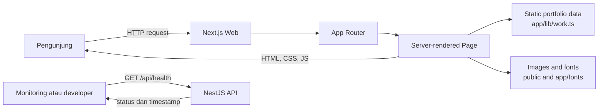
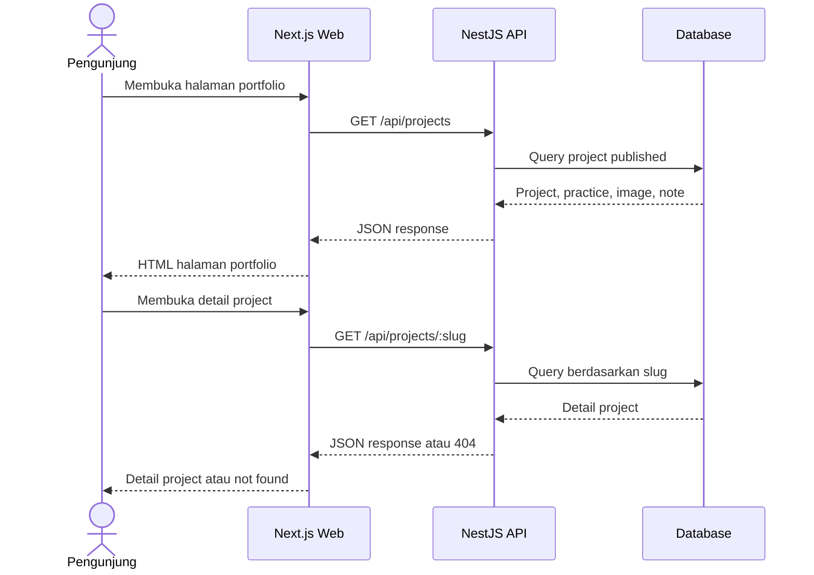

# Flow Aplikasi

## Flow saat ini

Saat ini website tidak bergantung pada API untuk merender portfolio. Karena itu,
gangguan API tidak menghalangi halaman portfolio statis untuk ditampilkan.

## Flow target ketika data dikelola API

Flow target belum diimplementasikan. Penambahan database, endpoint portfolio,
cache, serta penanganan kegagalan API harus dibuat dan diuji sebelum frontend
beralih dari data statis.

