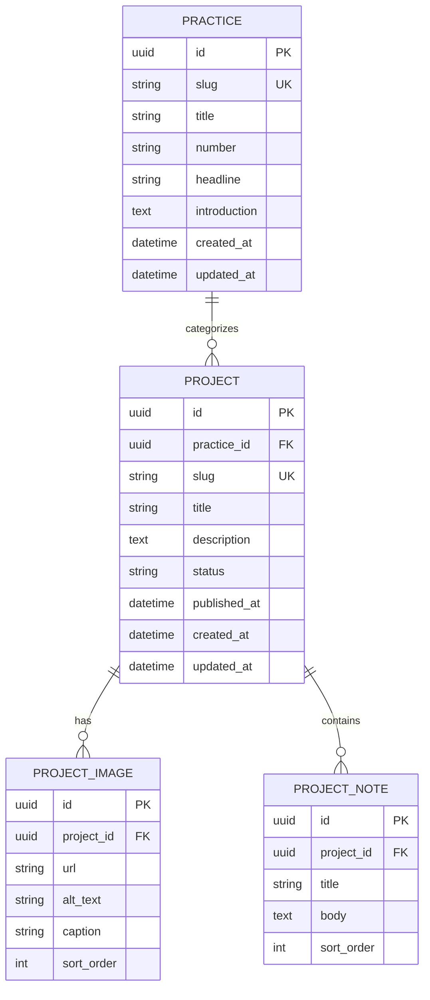

# Entity Relationship Diagram

## Status

Diagram berikut adalah rancangan model data untuk fase ketika portfolio telah
dipindahkan dari file statis frontend ke database. Implementasi saat ini belum
memiliki database; sumber data masih berada di `apps/web/app/lib/work.ts`.

## Aturan model

- `slug` pada practice dan project harus unik dan URL-safe.
- Satu project berada dalam satu practice; satu practice dapat memiliki banyak
  project.
- Project dapat memiliki nol atau lebih gambar dan catatan.
- `alt_text` wajib diisi untuk gambar informatif.
- `sort_order` menentukan urutan tampilan gambar dan catatan.
- Project hanya dapat ditampilkan kepada publik ketika statusnya `published`.

